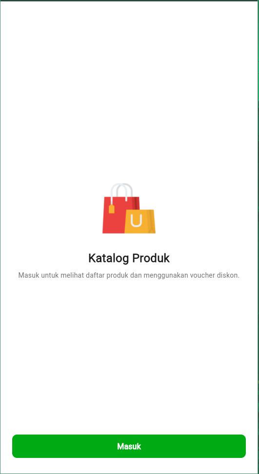
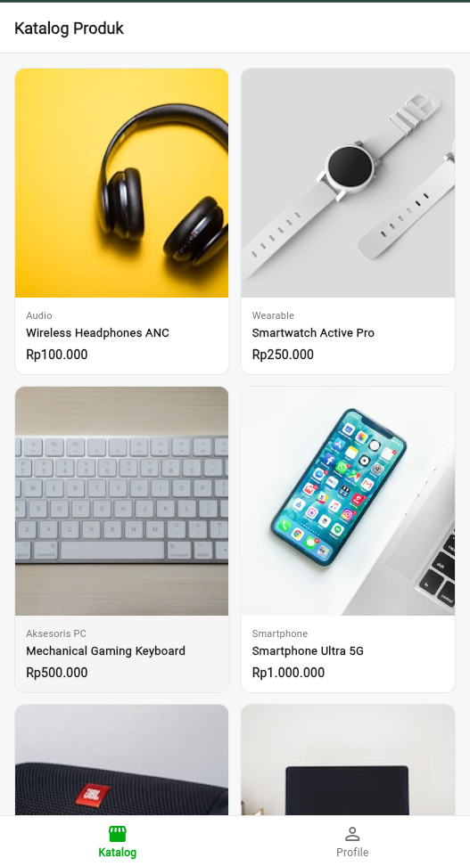
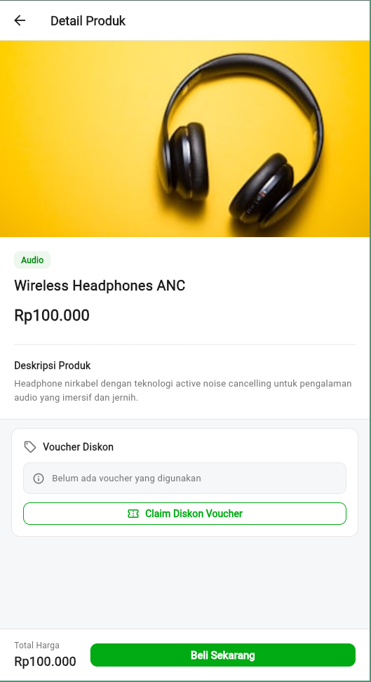
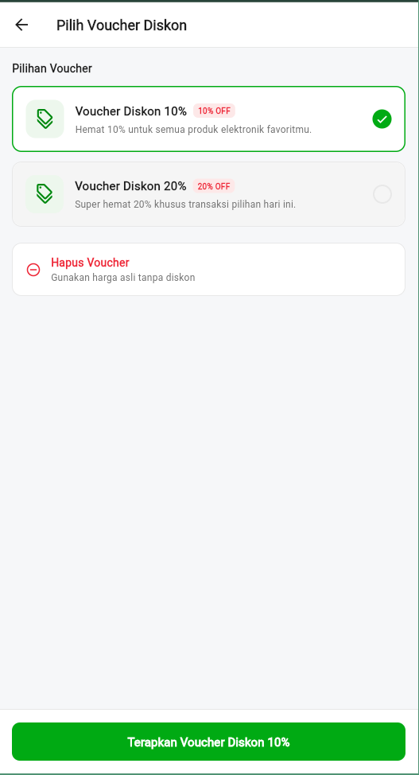
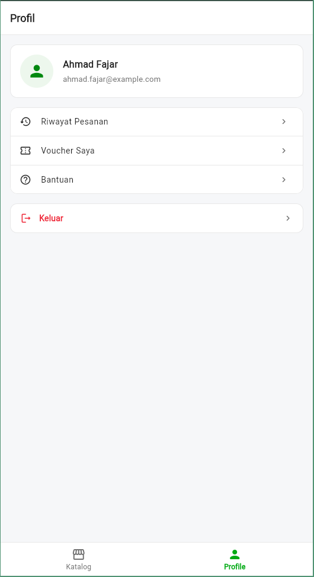

# Aplikasi Katalog Produk dan Voucher

Aplikasi mobile berbasis Flutter untuk menampilkan katalog produk dan menerapkan voucher diskon pada transaksi belanja.

## Alur Aplikasi

### 1. Halaman Login

Halaman awal untuk masuk ke dalam aplikasi. Pengguna menekan tombol masuk untuk menuju dashboard utama.

### 2. Halaman Katalog

Menampilkan daftar produk dalam bentuk grid dua kolom. Setiap item menampilkan gambar, kategori, nama, dan harga produk. Pengguna dapat menekan salah satu produk untuk membuka detail produk.

### 3. Halaman Detail Produk

Menampilkan rincian produk, harga asli, status voucher yang sedang digunakan, dan total harga akhir setelah diskon. Pengguna dapat menekan tombol klaim voucher untuk memilih diskon.

### 4. Halaman Pemilihan Voucher

Menampilkan pilihan voucher diskon yang tersedia yaitu diskon 10 persen dan diskon 20 persen. Voucher yang dipilih akan diterapkan pada harga produk di halaman detail. Terdapat juga opsi untuk membatalkan voucher.

### 5. Halaman Profil

Menampilkan data pengguna seperti foto, nama, email, menu navigasi akun, serta tombol keluar dari akun.

